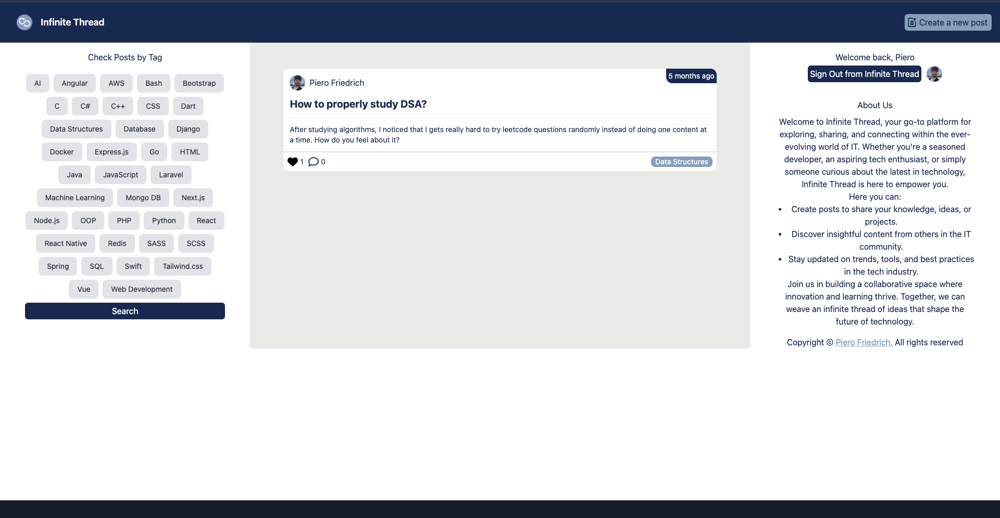
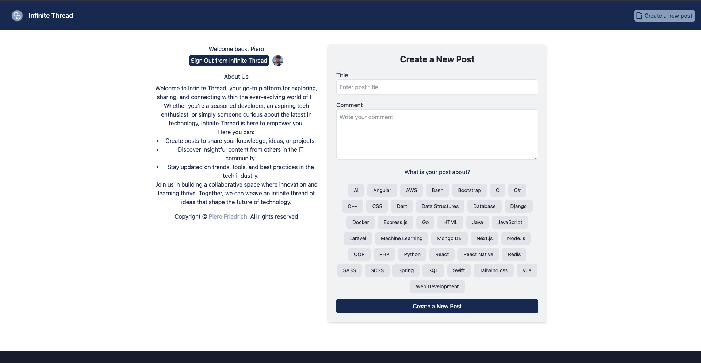
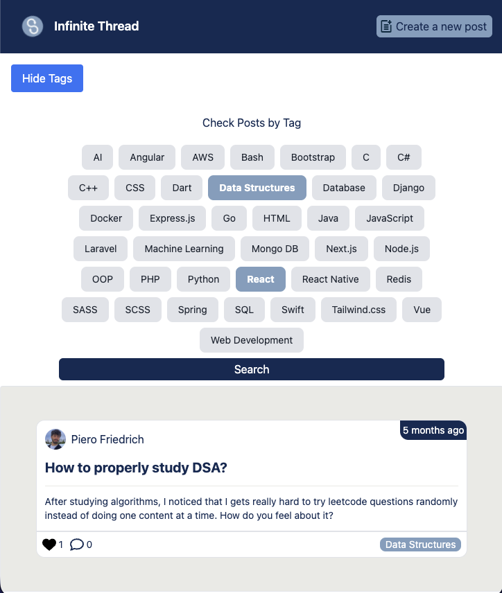
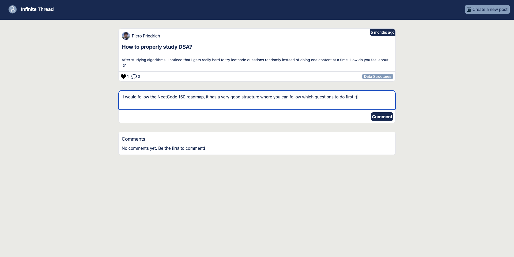

# InfiniteThread

A community forum for developers to share posts, discuss topics, and engage through comments and likes — organized by technology tags.

**Live:** [infinite-thread-client-hostinger.vercel.app](https://infinite-thread-client-hostinger.vercel.app/)

---

## Screenshots

<table>
  <tr>
    <td align="center"><strong>Home Feed</strong><br></td>
    <td align="center"><strong>Create a Post</strong><br></td>
  </tr>
  <tr>
    <td align="center"><strong>Filter by Tag</strong><br></td>
    <td align="center"><strong>Comments</strong><br></td>
  </tr>
</table>

---

## Features

- Browse posts in a chronological feed
- Create posts with a title, description, and image
- Tag posts with 38 predefined tech/language tags (JavaScript, React, Python, etc.)
- Filter the feed by one or more tags
- Like and unlike posts
- Comment on posts and view full comment threads
- Google OAuth sign-in

---

## Tech Stack

**Frontend**
- React 18 + Vite
- Tailwind CSS
- React Router v6
- Axios
- Google OAuth (`@react-oauth/google`)

**Backend**
- Node.js + Express
- MySQL (via `mysql2`)
- Deployed on Vercel

---

## Getting Started

### Prerequisites
- Node.js 18+
- MySQL database
- Google OAuth client ID

### Client

```bash
cd client
npm install
npm run dev
```

### Server

```bash
cd server
npm install
node app.js
```

Create a `.env` file in `server/` with your database credentials and Google OAuth client ID before starting the server.
